<div align="center">

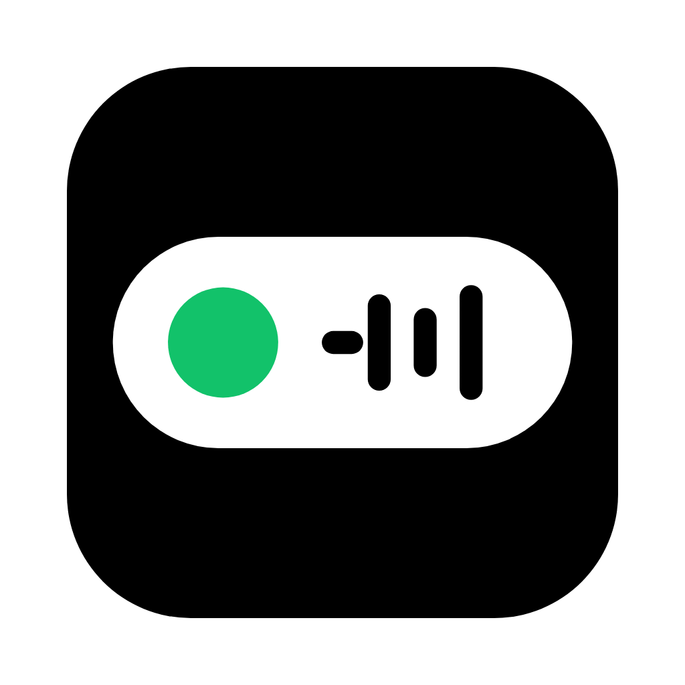

# Point Taken

[](app/macos/Package.swift)
[](#requirements)
[](scripts/.python-version)
[](https://github.com/k2-fsa/sherpa-onnx)
[](LICENSE)

**Talk while you mark up your screen, and get your point across.**

English | [中文](README.zh-CN.md)

</div>

<p align="center">
  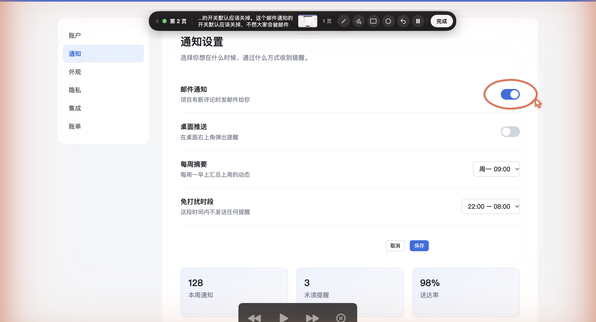
</p>

## About

Point Taken is a macOS menu bar tool. Hold a shortcut, draw on your screen, and say what you mean. It lines up the screenshots, your marks and your words by time, and turns them into one illustrated note you can paste to a teammate or an AI in one go.

## ❤️ Sponsors

> [Want to appear here?](https://github.com/yanshuxiang/point-taken/issues)

<details open>
<summary>Click to collapse</summary>

<!--
  To add a sponsor, replace the placeholder below with:

  <a href="https://sponsor.example"></a>

  **[Sponsor name](https://sponsor.example)** — one or two sentences about the sponsor.

  Put the banner in assets/sponsors/ (1200×200 PNG or SVG works best). Separate sponsors with a --- line.
-->

<a href="https://github.com/yanshuxiang/point-taken/issues"></a>

**Your brand here** — Point Taken is used by people who explain their work to teammates and AI every day. Sponsor the project to put your banner and a short description in this spot.

</details>

---

## Features

- 🎙️ **Talk and mark**: capture the screen, circle what matters, and your speech is transcribed and attached to the mark it belongs to.
- 📑 **Many pages in one go**: mark up several pages in a row; long pages can scroll and stitch into one tall image.
- 🔍 **Review before sending**: zoom into each mark, edit its note, or drop a page.
- 📋 **Paste once**: the finished note pastes straight into a chat app, a document or an AI chat.
- 🗂️ **History**: everything you marked stays on your Mac and can be found again.
- 🔒 **Local first**: speech runs on your Mac by default; cloud services are opt-in.

## Screenshots

<table>
  <tr>
    <td width="50%" align="center">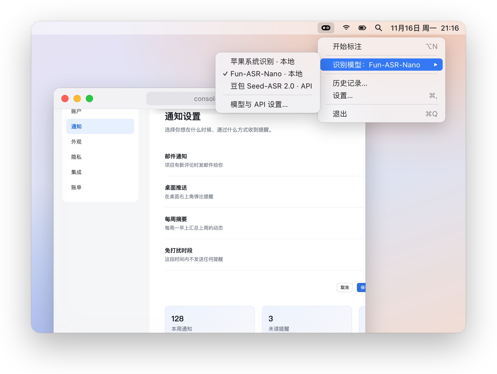<br><sub>Everything starts from the menu bar</sub></td>
    <td width="50%" align="center">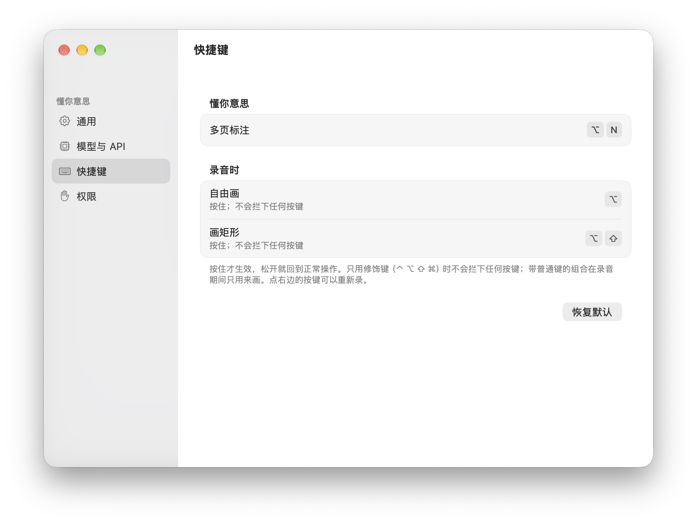<br><sub>Shortcuts you can change</sub></td>
  </tr>
  <tr>
    <td align="center">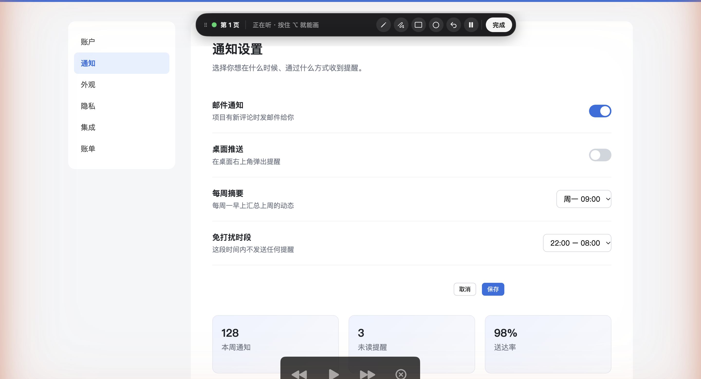<br><sub>First start: the shortcuts at a glance</sub></td>
    <td align="center"><br><sub>Your words appear live while you mark</sub></td>
  </tr>
  <tr>
    <td align="center">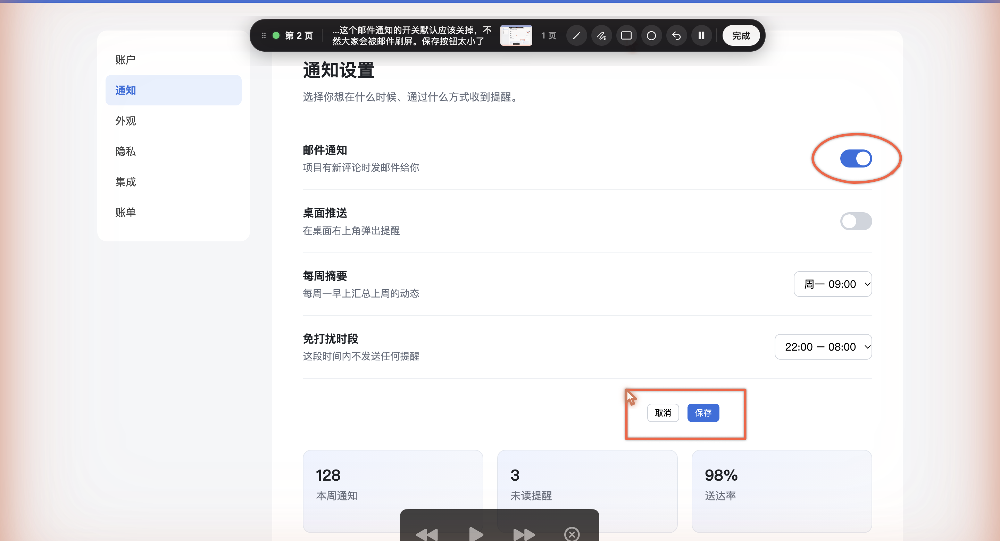<br><sub>Freehand, box and ellipse</sub></td>
    <td align="center">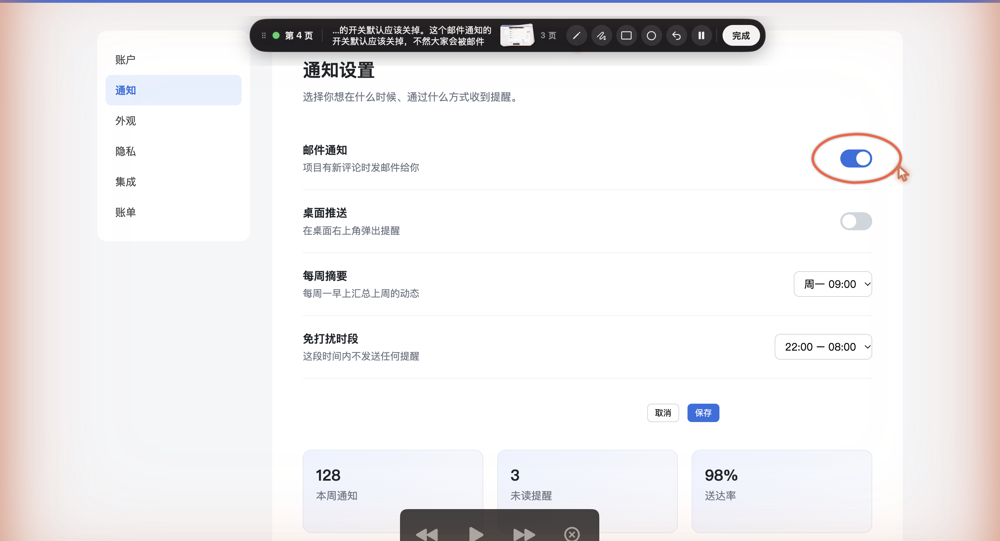<br><sub>Save a page and keep going</sub></td>
  </tr>
  <tr>
    <td align="center">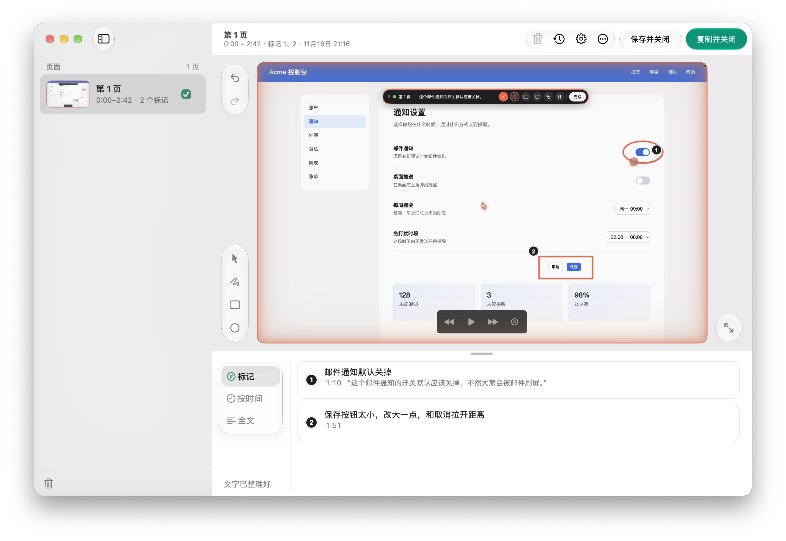<br><sub>Review each mark before sending</sub></td>
    <td align="center">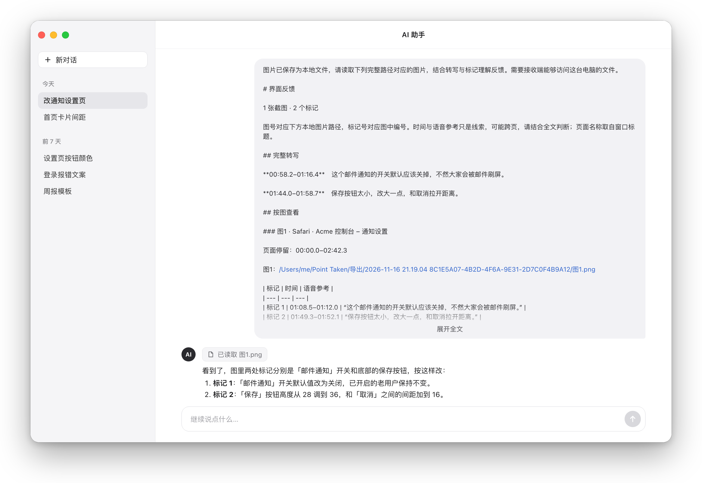<br><sub>Pasted into an AI chat in one go</sub></td>
  </tr>
  <tr>
    <td align="center">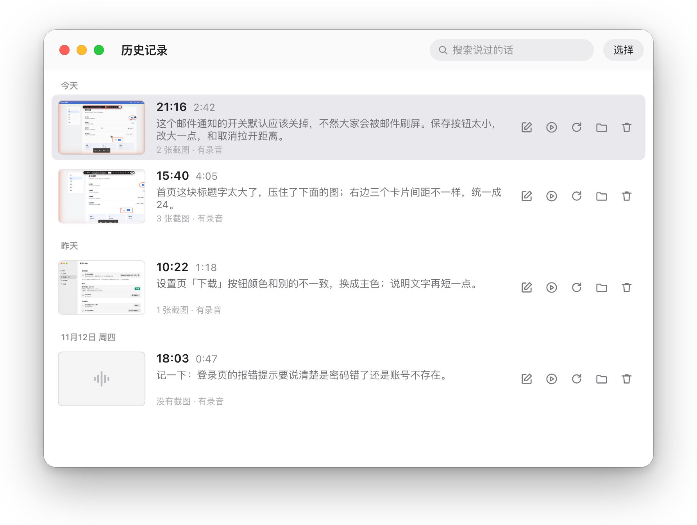<br><sub>Find past sessions in History</sub></td>
    <td align="center">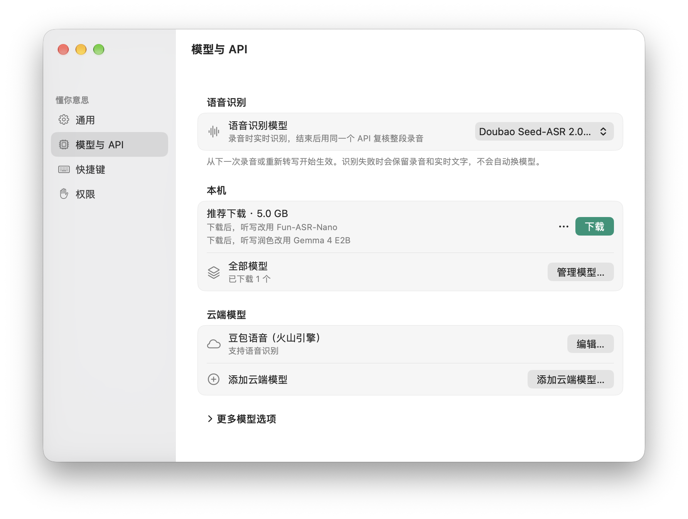<br><sub>Local or cloud speech, your choice</sub></td>
  </tr>
</table>

## How it works

1. Press <kbd>⌥</kbd> <kbd>N</kbd>. A capsule appears at the top of the screen and Point Taken starts recording.
2. Hold <kbd>⌥</kbd> and draw while you talk. Let go and the mouse works normally again, so you can click and scroll to the next page.
3. The capsule shows your words as you speak, plus tools for freehand, box, circle, undo and pause.
4. Click **完成** (Done) on the capsule. The review window opens with every page and the words matched to each mark.
5. Check it, then paste the note, as images plus text, into a chat, a document or an AI.

### Default shortcuts

| Shortcut | Action |
| --- | --- |
| <kbd>⌥</kbd> <kbd>N</kbd> | Start marking |
| Hold <kbd>⌥</kbd> | Draw freehand while held |
| Hold <kbd>⌥</kbd> <kbd>⇧</kbd> | Draw a box while held |

Holding keys never blocks other apps: modifier-only shortcuts pass through, and the drawing stops when you let go. All shortcuts can be changed under **Settings → Shortcuts**.

## Speech options

Pick a speech service under **Settings → Models & API**.

| Option | Where it runs | Notes |
| --- | --- | --- |
| This Mac (default) | Locally, via [sherpa-onnx](https://github.com/k2-fsa/sherpa-onnx) | SenseVoice Small by default (Chinese, English, Japanese, Korean, Cantonese). Downloaded on first use. |
| Volcengine, DashScope (Qwen3-ASR), OpenAI, Groq | Cloud | Uses your own API key, which is kept in the macOS Keychain. |

Voice activity detection uses [Silero VAD](https://github.com/snakers4/silero-vad), which ships in `models/` so the first recording needs no download.

## Requirements

- macOS 13 or later (macOS 26 gets the Liquid Glass look)
- Xcode to build (the build uses Xcode's toolchain; the stock Command Line Tools are too old)
- [uv](https://docs.astral.sh/uv/) at runtime for the speech scripts. If it isn't on your `PATH`, the app offers to install it into `~/.point-taken/bin`.

## Build and install

```bash
./build.sh
```

The script builds the app, installs it to `/Applications/Point Taken.app` and opens it. On first run, macOS asks for Screen Recording, Microphone and Accessibility access.

To use a different Xcode, set `DEVELOPER_DIR` first:

```bash
DEVELOPER_DIR=/Applications/Xcode-beta.app/Contents/Developer ./build.sh
```

## Where your data lives

| What | Where |
| --- | --- |
| Marked sessions | `~/Point Taken/记录` |
| Exports | `~/Point Taken/导出` |
| Settings and speech models | `~/.point-taken` |

Your records stay on your Mac. Speech is sent to a cloud service only if you choose one in Settings.

## Development

### Repository layout

```
app/macos/              Swift package (SwiftPM) for the app
  Sources/PointTakenApp   AppKit app: Capture/ (capsule, ink, paging, review, history),
                          App/ (menu, hotkeys, model downloads), Settings/, Onboarding/
  Sources/PointTakenCore  Config, paths, script runner, archive and exports (no UI)
  Sources/PointTakenObjC  Catches Objective-C exceptions from AVFoundation
  Tests/                  Swift unit tests for PointTakenCore
  build-app.sh            Builds the .app bundle and installs it
scripts/                Python scripts the app runs through uv
  transcribe.py           Speech-to-text with timestamps (VAD first, then the chosen model)
  board_live.py           Live captions for a marking session
  polish.py               Optional local clean-up of transcripts (MLX, Apple Silicon)
  polish_cloud.py         The same clean-up through a cloud model you configure
  *_models.json           Model registries
models/                 Bundled Silero VAD model
assets/                 App icons and sponsor banners
tests/                  Python tests (pytest)
docs/                   Design notes, investigation write-ups and screenshots
```

The Swift app owns the UI, capture and storage. Speech work runs in the Python scripts, which declare their own dependencies inline ([PEP 723](https://peps.python.org/pep-0723/)), so `uv run` sets them up with no separate install step. Their Python version is pinned in `scripts/.python-version`.

### Running tests

Swift:

```bash
DEVELOPER_DIR=/Applications/Xcode.app/Contents/Developer swift test --package-path app/macos
```

Python, one file:

```bash
uv run --with numpy --with pytest pytest tests/test_asr_select.py -q
```

Every Python test run gets its own temporary `POINT_TAKEN_HOME`, so tests never touch your real `~/.point-taken`. Tests that open the app's windows are skipped unless `POINT_TAKEN_GUI_TESTS=1` is set.

## License

[MIT](LICENSE)
