<div align="center">


# 懂你意思

[](app/macos/Package.swift)
[](#系统要求)
[](#)
[](scripts/.python-version)
[](https://github.com/k2-fsa/sherpa-onnx)
[](LICENSE)

**一边说、一边在屏幕上圈圈画画，就能把你的意思讲清楚。**

🍎 **macOS 版已发布** —— [下载最新版本](https://github.com/yanshuxiang/point-taken/releases/latest) · 🪟 **Windows 版正在测试，即将到来**

[English](README.md) | 中文

</div>

<p align="center">
  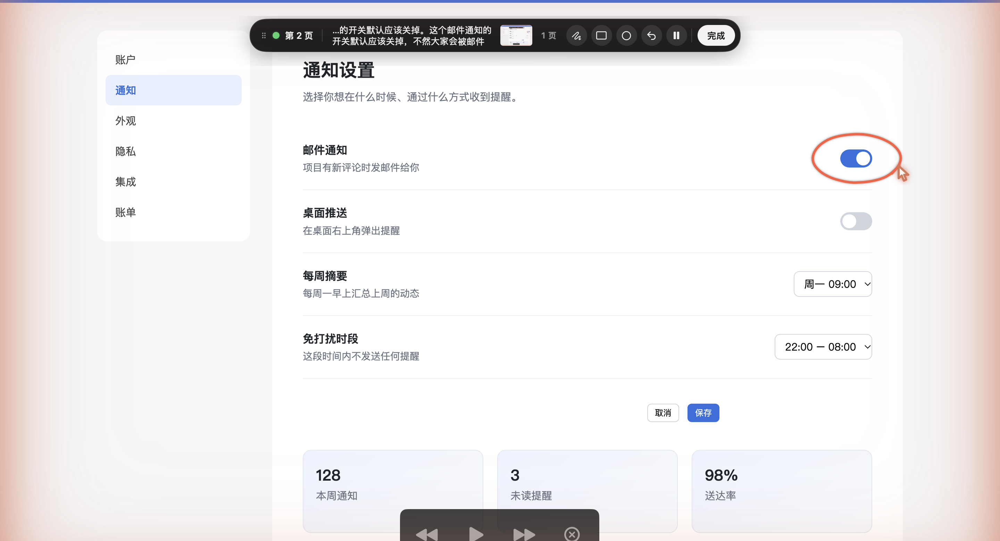
</p>

## 简介

懂你意思（Point Taken）是一个 macOS 菜单栏小工具：按住快捷键，在屏幕上标注，同时说出你想说的话。它会把截图、标注和你说的话按时间对齐，整理成一份带图的说明，一次粘贴给同事或 AI。

## 🎬 演示视频

<p align="center">
  <a href="https://www.bilibili.com/video/BV1tUsB6nE7d/">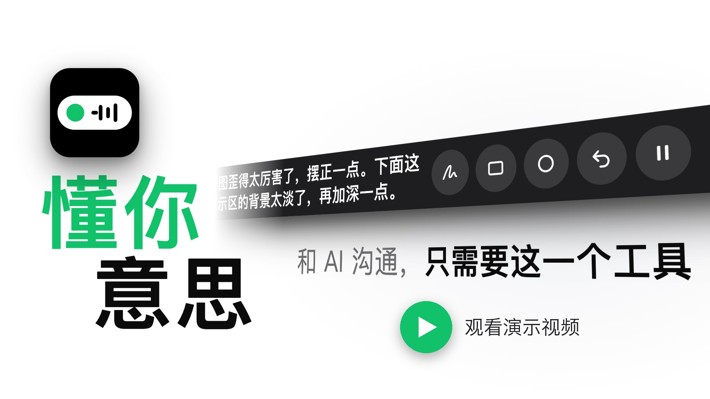</a>
  <br><sub>点击图片到 B 站观看</sub>
</p>

## ❤️ 赞助商

> 想出现在这里？发邮件到 [xinyuanzaizhe@gmail.com](mailto:xinyuanzaizhe@gmail.com)

<details open>
<summary>点击收起</summary>

<!--
  添加赞助商：在下面的表格里加一行：

  <tr>
  <td width="180"><a href="https://sponsor.example"></a></td>
  <td>感谢 赞助商 赞助本项目！<a href="https://sponsor.example">赞助商</a> 是……一两句话介绍。</td>
  </tr>

  标志放在 assets/sponsors/（600×200 的 SVG 或 PNG 效果最好）。
-->

<table>
<tr>
<td width="180" align="center"><a href="https://www.douyin.com/user/MS4wLjABAAAAzRM2Reu24mscMJE0V0gJrEC8y5Ija30YyzYGbwtZ4xcDcIRh9l8q8iQ27-0mL-Qz">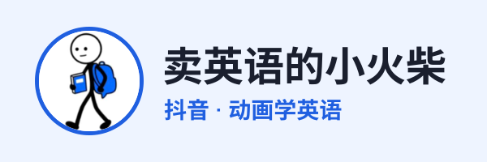</a></td>
<td>感谢 卖英语的小火柴 赞助本项目！<a href="https://www.douyin.com/user/MS4wLjABAAAAzRM2Reu24mscMJE0V0gJrEC8y5Ija30YyzYGbwtZ4xcDcIRh9l8q8iQ27-0mL-Qz">卖英语的小火柴</a> 是抖音上的英语学习博主，用最通俗易懂的动画讲英语，有「实景英语」和「外刊解读」等系列，带你在真实场景和外刊原文里学英语。欢迎去 <a href="https://www.douyin.com/user/MS4wLjABAAAAzRM2Reu24mscMJE0V0gJrEC8y5Ija30YyzYGbwtZ4xcDcIRh9l8q8iQ27-0mL-Qz">抖音主页</a> 关注。</td>
</tr>
<tr>
<td width="180" align="center"><a href="https://space.bilibili.com/695032460">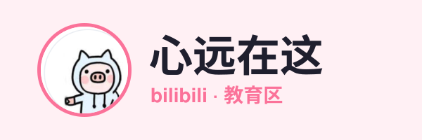</a></td>
<td>感谢 心远在这 赞助本项目！<a href="https://space.bilibili.com/695032460">心远在这</a> 是 B 站教育区 UP 主，把大学理工科课程做成直观的动画：高数、线代、模电、工程电磁学，还有 RoboMaster 视觉和 ROS 2 入门。想把难懂的课轻松看懂，欢迎去 <a href="https://space.bilibili.com/695032460">B 站主页</a> 关注。</td>
</tr>
<tr>
<td width="180" align="center"><a href="https://www.linkedin.com/in/nawal-al-hadrani-014779262/">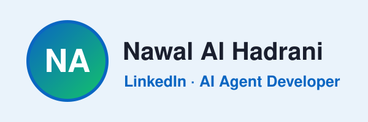</a></td>
<td>感谢 Nawal Al Hadrani 赞助本项目！<a href="https://www.linkedin.com/in/nawal-al-hadrani-014779262/">Nawal Al Hadrani</a> 是瑞典哥德堡的 AI Agent 开发者，正在打造一个替企业预约会议的 AI 助手。欢迎去 <a href="https://www.linkedin.com/in/nawal-al-hadrani-014779262/">领英主页</a> 关注。</td>
</tr>
</table>

</details>

---

## 功能

- 🎙️ **边说边标**：截取屏幕，用画笔圈出重点，说话会自动转成文字，并挂到对应的标注上。
- 📑 **多页连续标注**：一次可以标好几页，长页面能自动滚动拼成长图。
- 🔍 **检查后再发**：发出前可以放大查看每一处标注、改说明、删页。
- 📋 **一次粘贴**：整理好的图文直接粘贴到聊天软件、文档或 AI 对话框里。
- 🗂️ **历史记录**：做过的标注都保存在本机，可以随时找回来。
- 🔒 **本地优先**：默认在本机转写语音，云端服务需要你自己打开。

## 截图

<table>
  <tr>
    <td width="50%" align="center">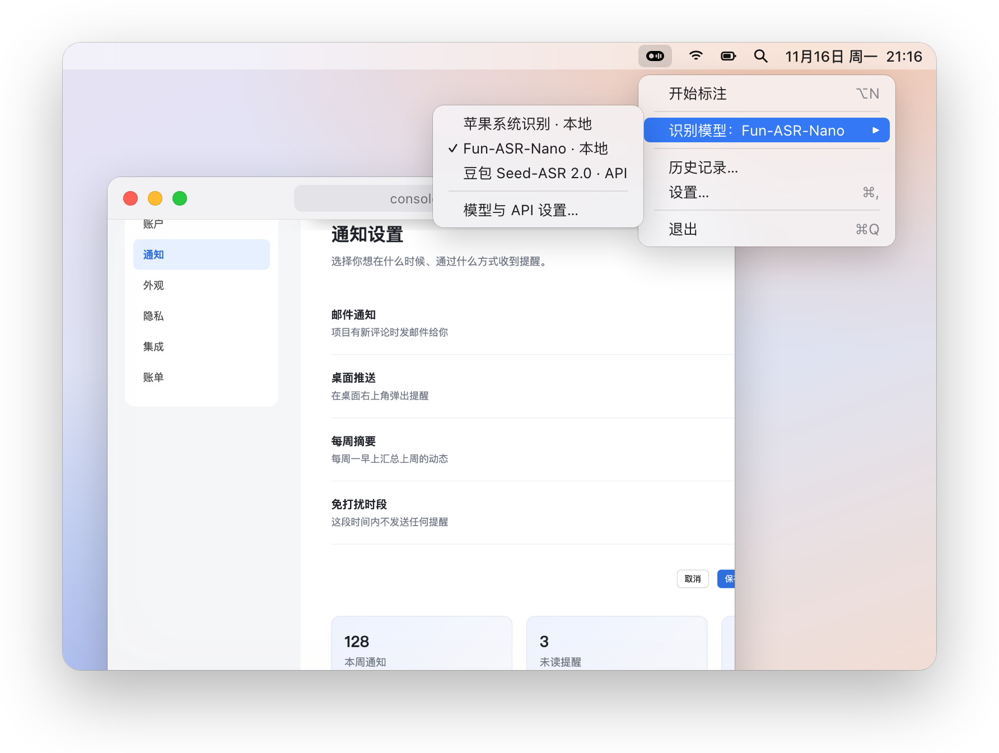<br><sub>一切从菜单栏开始</sub></td>
    <td width="50%" align="center">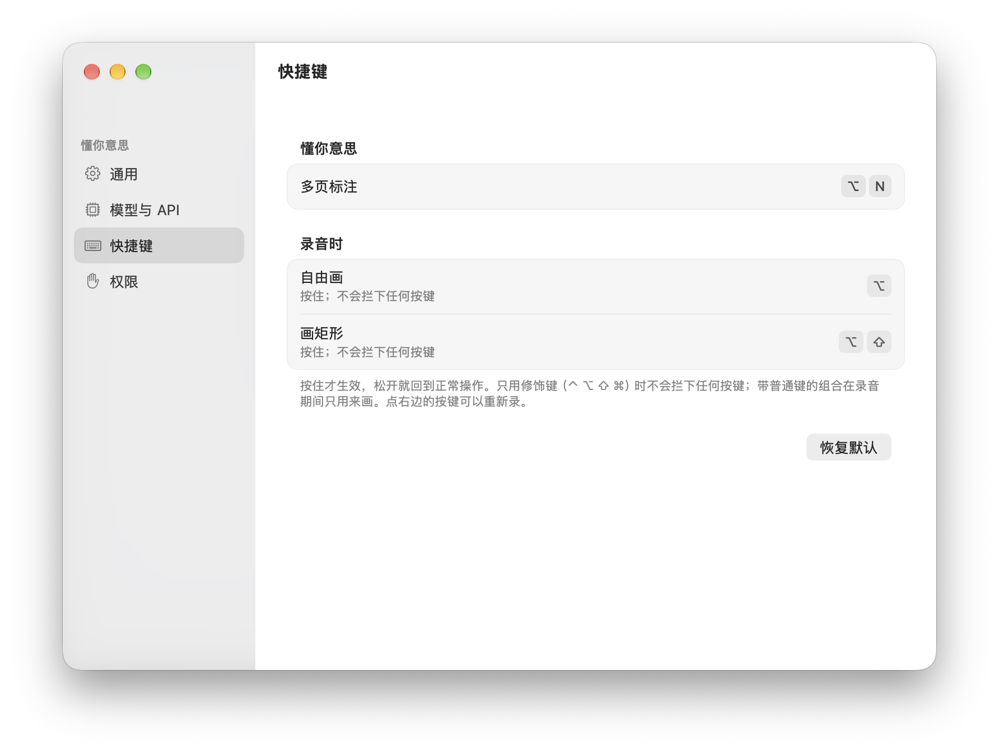<br><sub>快捷键可以自己改</sub></td>
  </tr>
  <tr>
    <td align="center">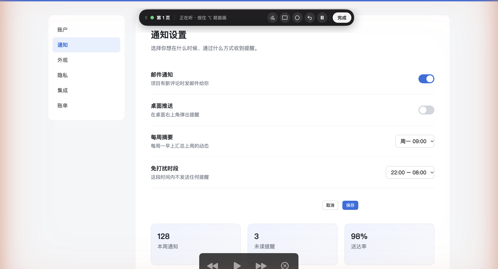<br><sub>第一次开始：快捷键一目了然</sub></td>
    <td align="center"><br><sub>边标边说，文字实时出现</sub></td>
  </tr>
  <tr>
    <td align="center"><br><sub>画笔、画框、画圈</sub></td>
    <td align="center">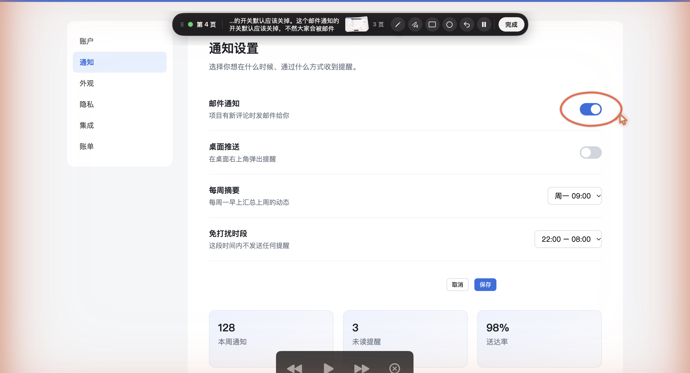<br><sub>存一页，接着标下一页</sub></td>
  </tr>
  <tr>
    <td align="center"><br><sub>发出前逐条检查</sub></td>
    <td align="center">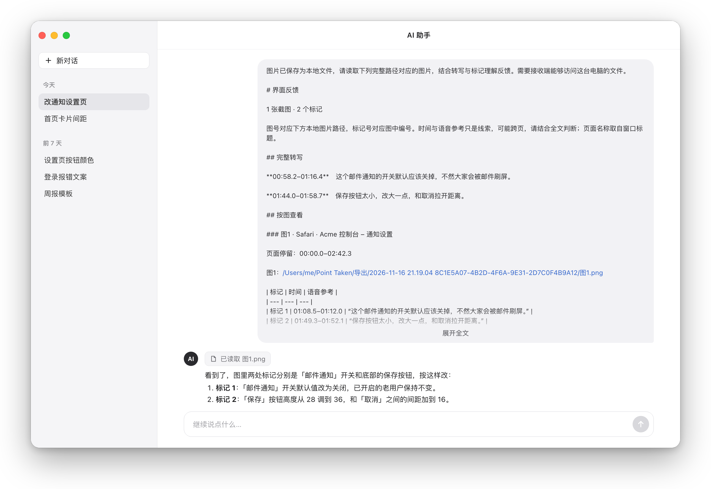<br><sub>一次粘贴到 AI 对话框</sub></td>
  </tr>
  <tr>
    <td align="center">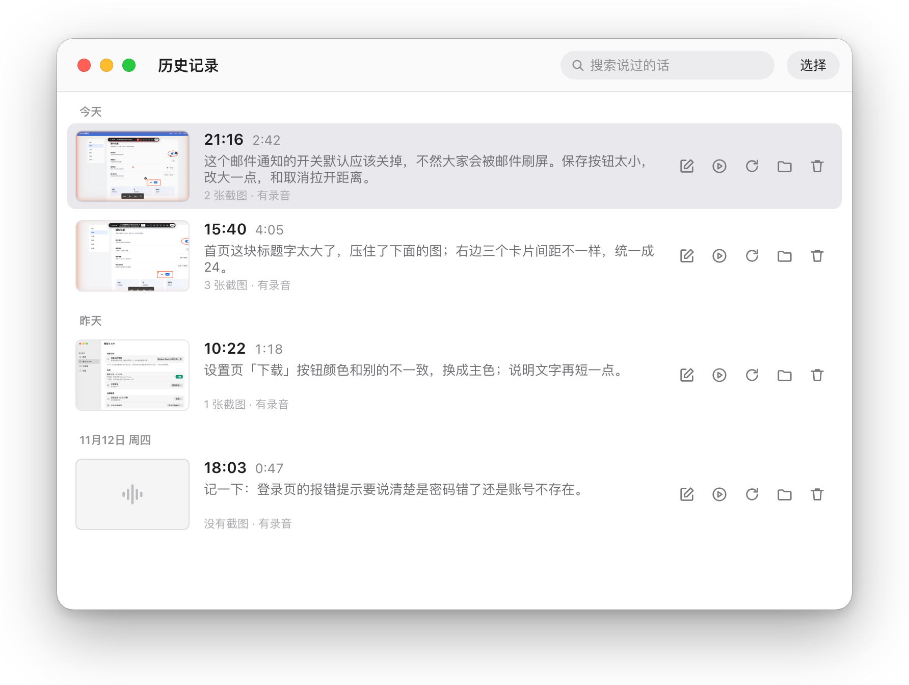<br><sub>在历史记录里找回以前的标注</sub></td>
    <td align="center">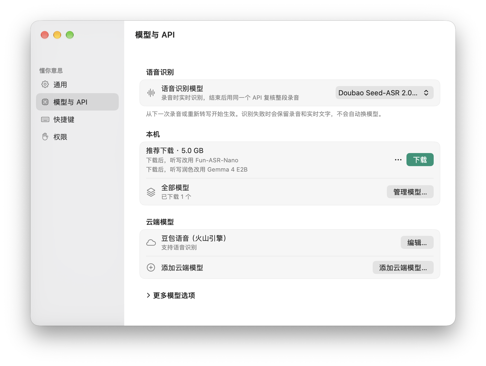<br><sub>本地或云端转写，随你选</sub></td>
  </tr>
</table>

## 怎么用

1. 按 <kbd>⌥</kbd> <kbd>N</kbd>，屏幕顶部出现一个胶囊，开始录音。
2. 按住 <kbd>⌥</kbd> 边说边画；松开就回到正常操作，可以照常点击、滚动到下一页。
3. 胶囊里会实时显示你说的话，还有自由画、矩形、圆圈、撤销和暂停按钮。
4. 点胶囊上的 **完成**，打开检查窗口：每一页截图，以及对到每处标注上的话。
5. 检查好后，把图文一起粘贴到聊天软件、文档或 AI 对话框里。

### 默认快捷键

| 快捷键 | 作用 |
| --- | --- |
| <kbd>⌥</kbd> <kbd>N</kbd> | 开始标注 |
| 按住 <kbd>⌥</kbd> | 按住时自由画 |
| 按住 <kbd>⌥</kbd> <kbd>⇧</kbd> | 按住时画矩形 |

按住才生效，松开就回到正常操作；只用修饰键时不会拦下任何按键。所有快捷键都可以在 **设置 → 快捷键** 里修改。

## 语音转写

在 **设置 → 模型与 API** 里选择转写服务。

| 选项 | 在哪里运行 | 说明 |
| --- | --- | --- |
| 本机（默认） | 本地，基于 [sherpa-onnx](https://github.com/k2-fsa/sherpa-onnx) | 默认用 SenseVoice Small（中、英、日、韩、粤语），第一次使用时下载。 |
| 火山引擎、阿里云百炼（Qwen3-ASR）、OpenAI、Groq | 云端 | 用你自己的 API Key，Key 保存在 macOS 钥匙串里。 |

语音检测用的是 [Silero VAD](https://github.com/snakers4/silero-vad)，模型随仓库放在 `models/` 里，第一次录音不用额外下载。

## 系统要求

- macOS 13 或更新版本（在 macOS 26 上会使用新的液态玻璃外观）
- 编译需要 Xcode（用的是 Xcode 自带的工具链，系统自带的命令行工具太旧，编不过）
- 运行时语音脚本需要 [uv](https://docs.astral.sh/uv/)。如果 `PATH` 里没有，App 会提示帮你装到 `~/.point-taken/bin`。

## 编译和安装

```bash
./build.sh
```

脚本会编译并安装到 `/Applications/Point Taken.app`，然后启动它。第一次运行时，系统会请求屏幕录制、麦克风和辅助功能权限。

要用别的 Xcode，先设置 `DEVELOPER_DIR`：

```bash
DEVELOPER_DIR=/Applications/Xcode-beta.app/Contents/Developer ./build.sh
```

## 数据存放在哪里

| 内容 | 位置 |
| --- | --- |
| 标注记录 | `~/Point Taken/记录` |
| 导出文件 | `~/Point Taken/导出` |
| 设置和转写模型 | `~/.point-taken` |

记录都保存在你的电脑上。只有在设置里选了云端语音服务时，语音才会发送到云端转写。

## 开发

### 目录结构

```
app/macos/              App 的 Swift 包（SwiftPM）
  Sources/PointTakenApp   AppKit 界面：Capture/（胶囊、画笔、翻页、检查、历史）、
                          App/（菜单、快捷键、模型下载）、Settings/、Onboarding/
  Sources/PointTakenCore  配置、路径、脚本调用、记录存档和导出（不含界面）
  Sources/PointTakenObjC  接住 AVFoundation 抛出的 Objective-C 异常
  Tests/                  PointTakenCore 的 Swift 单元测试
  build-app.sh            打包 .app 并安装
scripts/                App 通过 uv 调用的 Python 脚本
  transcribe.py           带时间戳的语音转写（先做语音检测，再交给选定的模型）
  board_live.py           标注过程中的实时字幕
  polish.py               可选：本地整理转写文字（MLX，Apple 芯片）
  polish_cloud.py         同样的整理，交给你配置的云端模型
  *_models.json           模型清单
models/                 随仓库附带的 Silero VAD 模型
assets/                 App 图标和赞助商标志
tests/                  Python 测试（pytest）
docs/                   设计笔记、调研记录和截图
```

Swift 部分负责界面、截屏和存储；语音相关的工作交给 Python 脚本。脚本在文件开头声明自己的依赖（[PEP 723](https://peps.python.org/pep-0723/)），`uv run` 会自动装好，不需要单独安装。Python 版本固定在 `scripts/.python-version`。

### 运行测试

Swift：

```bash
DEVELOPER_DIR=/Applications/Xcode.app/Contents/Developer swift test --package-path app/macos
```

Python（单个文件）：

```bash
uv run --with numpy --with pytest pytest tests/test_asr_select.py -q
```

每次跑 Python 测试都会用一个临时的 `POINT_TAKEN_HOME`，不会碰到你真正的 `~/.point-taken`。会在屏幕上打开 App 窗口的测试默认跳过，设置 `POINT_TAKEN_GUI_TESTS=1` 才会跑。

## 许可证

懂你意思（Point Taken）采用 [GNU 通用公共许可证 v3.0（GPL-3.0）](LICENSE)。你可以自由使用、修改和分享；但如果你发布修改后的版本，也必须以同样的协议公开源代码。

本项目最初基于 [Blurt](https://github.com/AGIHunt/blurt)（MIT 协议），其原始版权声明保留在 [NOTICE](NOTICE) 中。
