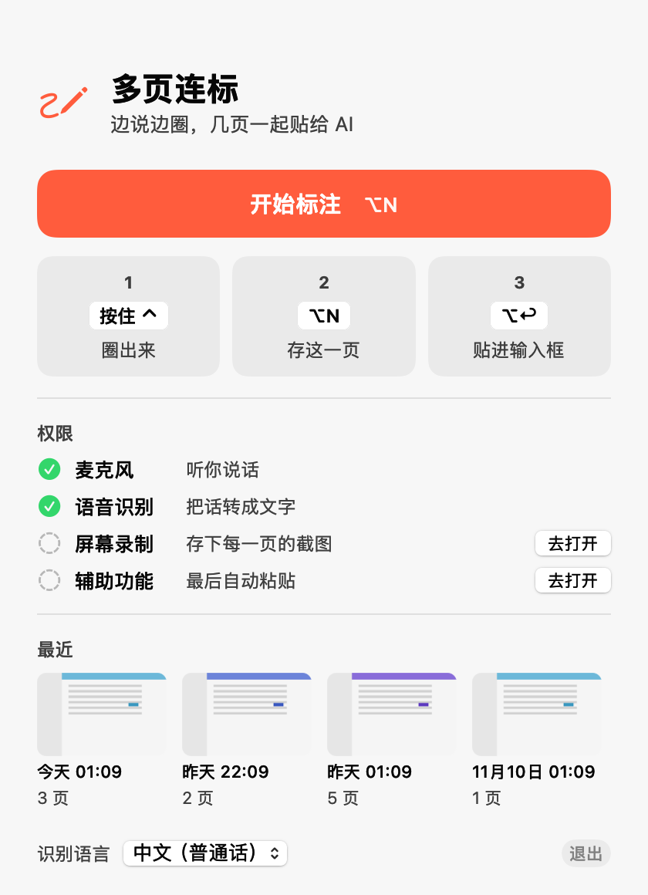
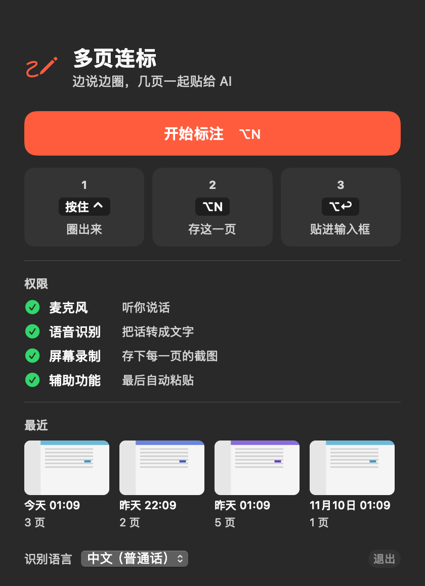
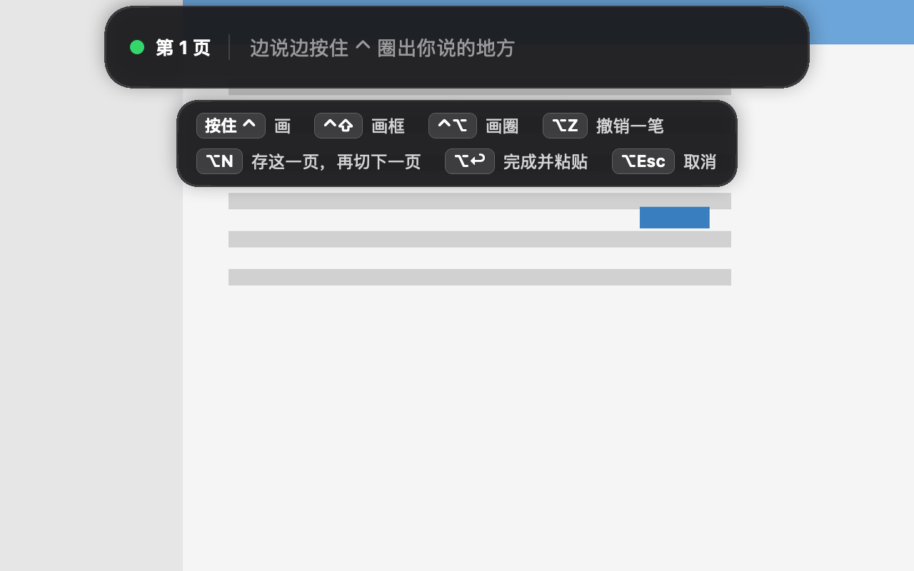
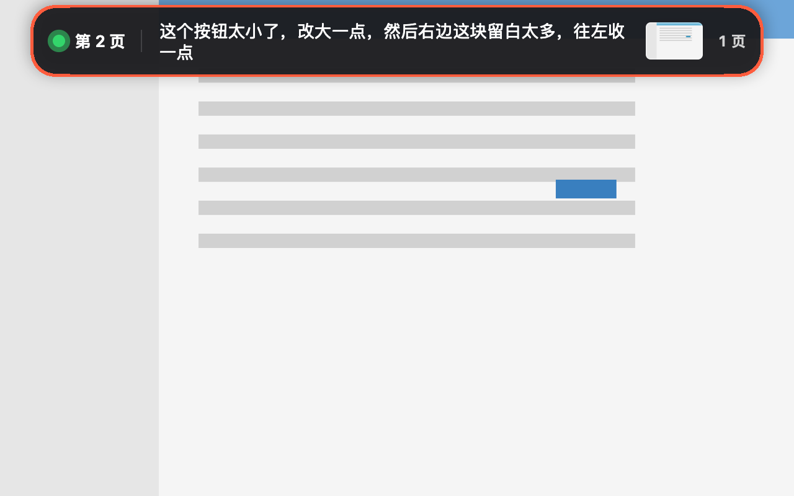
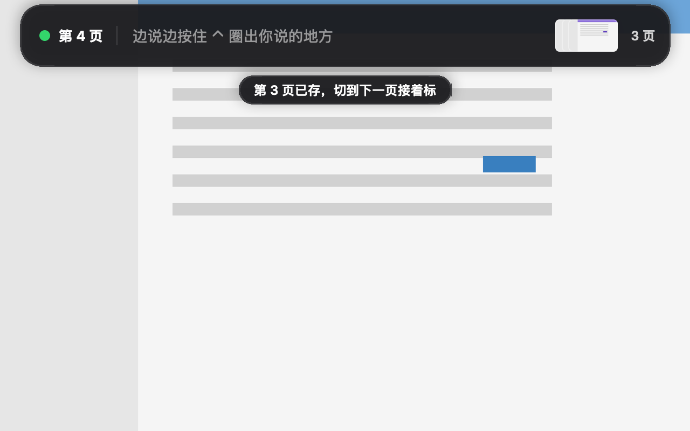
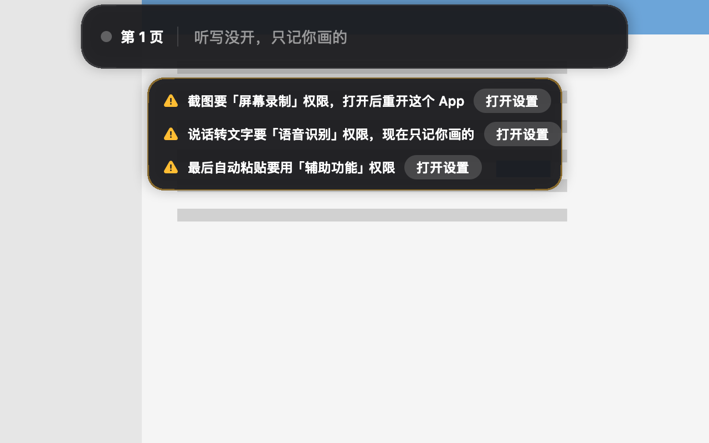
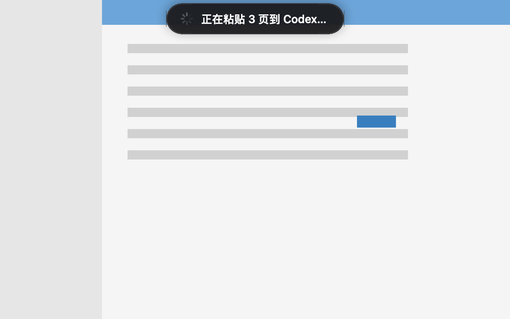
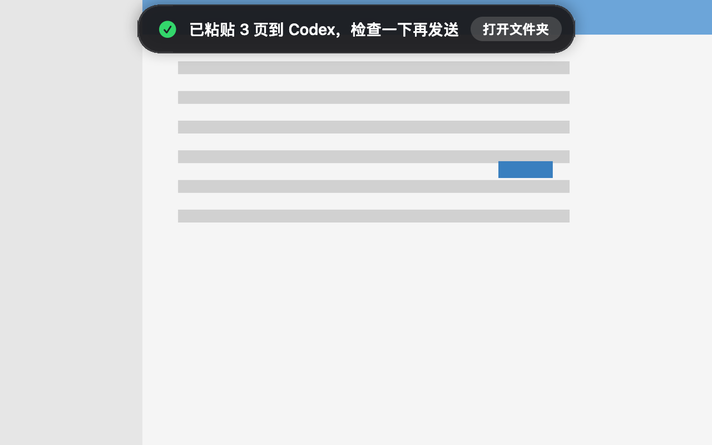
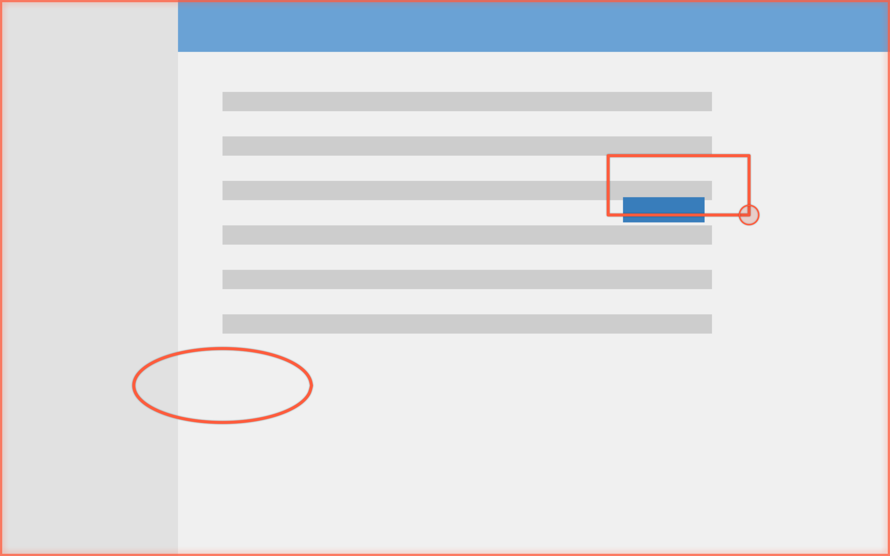

# 多页连标：设计与验证

> 最新产品决定见 [2026-11-14 需求确认](连标需求确认-2026-11-14.md)。以下旧界面图和快捷键流程保留作历史参考；当前修复已转为胶囊按钮控制。长截图调研见 [核心调研](长截图核心调研-2026-11-14.md)。

一次标好几页：边说边圈，每页一按，最后按顺序一次贴进 Codex / Claude 的输入框。

App：`/Applications/Point Taken 连标.app`（和官方 Point Taken 分开装，试的时候别同时开官方那个）。
代码：`app/macos/Sources/PointTakenApp/Capture/Board.swift`。
重新编译安装：`app/macos/build-app.sh`。
重画下面的界面图：`"/Applications/Point Taken 连标.app/Contents/MacOS/point-taken" --board-preview docs/board-preview`。

## 打开 App 看到的窗口

原来 Point Taken 的大主窗口、首次设置向导、其他快捷键（⌥A ⌥C ⌥R 等）和 Fn 听写，在这个版本里都关掉了，只留 ⌥N。
打开 App 是一个小窗口：开始按钮、三步用法、权限状态（缺的有「去打开」）、最近几次记录（点开是文件夹）、识别语言。
菜单栏图标的菜单也只剩：开始标注 / 打开窗口 / 打开记录文件夹 / 退出。

## 流程和每一步看到什么

| 步骤 | 按键 | 屏幕上 |
|---|---|---|
| 开始 | ⌥N（或菜单栏图标 → 多页连标） | 顶部落下一个深色胶囊：绿点（在听，跟着声音呼吸）、「第 1 页」、你说的话。前三次用会在下面列出按键，存了第一页就收起 |
| 标注 | 按住 ⌃ 拖动（⌃⇧ 画框，⌃⌥ 画圈） | 画笔开着时：屏幕边缘和胶囊外圈变橙色，光标处有橙色小圈。松开 ⌃ 就能正常点、滚、切页面 |
| 存一页 | ⌥N | 画过的屏幕闪一下，缩小飞进胶囊右边的缩略图堆，下面提示「第 1 页已存」，标注清空，变成「第 2 页」 |
| 改错 | ⌥Z 撤销一笔，⌥⌫ 删掉上一页 | 缩略图堆跟着变 |
| 完成 | ⌥↩ | 最后一页也存上，胶囊变成「正在粘贴 3 页到 Codex…」，然后「已粘贴 3 页到 Codex，检查一下再发送」+「打开文件夹」 |
| 取消 | ⌥Esc | 「已取消，这次的内容没有粘贴」 |

粘贴的顺序：图1 →「图1：这一页说的话」→ 图2 →「图2：……」。最前面是终端的话，改成一段文字：图片路径加说的话。粘完把你原来的剪贴板放回去。

每次的内容都存在 `~/Point Taken/连标/<时间>/`：`图1.png`、`图2.png`……、`说明.md`、`完整转写.txt` 和 `原始录音.wav`。完整转写独立于截图保存，包含背景及结束补充；默认粘贴截图与完整文字，原始音频保留在本地。

## 颜色只表达一件事

- 橙色：你的标注和画笔
- 绿色：麦克风在听 / 粘贴成功
- 琥珀色：缺权限，要你处理
- 其余都是深色玻璃和白字，层级靠字号和透明度

## 界面

## 第一次用要给的权限

都在「系统设置 › 隐私与安全性」里，胶囊下面的琥珀色卡片有「打开设置」按钮直接跳过去：

- 麦克风、语音识别：说话转文字（第一次按 ⌥N 会弹窗）
- 屏幕录制：存页面截图（打开后要退出再打开 App）
- 辅助功能：最后自动粘贴

## 验证清单

1. 打开 Codex，光标放进输入框。
2. ⌥N，看到顶部胶囊和按键提示；说一句话，胶囊里出字，绿点跟着跳。
3. 按住 ⌃ 圈一个按钮：边缘变橙、光标有橙圈；⌃⇧ 画个框。
4. ⌥N：屏幕闪一下，缩略图飞进胶囊，提示第 1 页已存。
5. 切到另一个页面，再说再画，⌥N。
6. ⌥↩：输入框里依次出现 图1、文字、图2、文字，胶囊提示已粘贴。
7. 打开 `~/Point Taken/连标/` 最新的文件夹，图和 `说明.md` 都在。

## 启动窗口回归检查

运行 `app/macos/.build/release/point-taken --board-startup-check`。
它启动独立的测试窗口，经过开始按钮的窗口切换流程，再检查胶囊内容是否完整落在窗口可见区域内；
覆盖首次显示、连续同尺寸刷新、权限提示、收起提示和完成消息。不会开麦、截图、请求权限或写入用户记录。
通过时输出 `"ok":true` 并返回 0，否则返回 1。
测试入口：`POINT_TAKEN_E2E=1 python3 -m unittest tests.test_board_startup -v`。
同时检查录音期间键盘释放、胶囊与画笔窗口无法取得键盘焦点、正常模式鼠标穿透，
以及设置窗口在前台时 ⌘Q 触发退出请求（测试代理取消实际退出）、⌘H 隐藏、隐藏后的转写刷新不重新弹出窗口，
以及提示按钮可点击、悬浮层的透明边缘允许点击穿透。

2026-11-14 的“开始后消失”：进程和胶囊窗口仍然存在，四项权限也已获准，但 `BoardCapsule.place()`
将内容视图设成 400 高来测量后没有恢复。当窗口尺寸不变时，`setFrame` 不会再次调整内容视图；
实际 201 高的窗口中，内容落在 y=219…396，全部被裁掉。回归检查必须验证内容坐标，不能只检查 `isVisible`。
另一个启动时序问题是入场动画保存了旧窗口高度，覆盖随后权限/状态刷新算出的新高度；入场动画改为只移动内容层，
不再改变窗口尺寸。布局时显式同步内容视图与窗口大小。

同次排查还发现连标主窗口的 `NSApp.mainMenu` 是空的，状态栏菜单里的“退出”不会给前台窗口建立标准快捷键；
悬浮层也曾在显示提示按钮时让整个透明窗口接收点击。前者需要安装标准应用菜单，后者需要按可见按钮的实际位置处理点击。

## 还没做

- 说「这个」时对应鼠标指在哪（按时间把话和鼠标位置对上）
- 完成前在面板里改字、调顺序
- Windows 版

## 录音与转写保留验证

`python3 -m unittest tests.test_board_archive -v` 使用合成音频验证未压缩文件的样本、长度、原采样率，以及转写修正、跨页和文字导出。
`point-taken --board-retention-check` 经过实际识别结果接收、存页、结束等待、保存文件和投递计划构建路径，检查背景与最后一句完整保留。不会访问真实麦克风或剪贴板。
